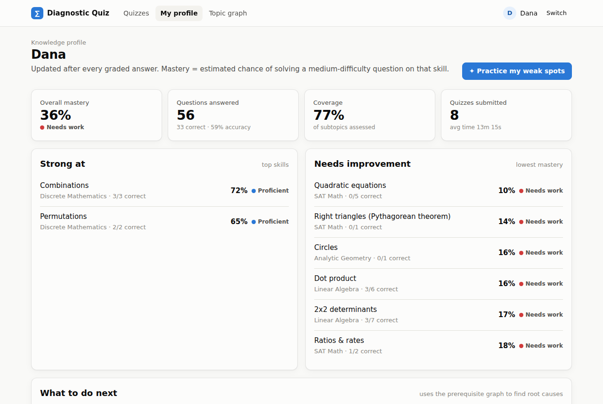
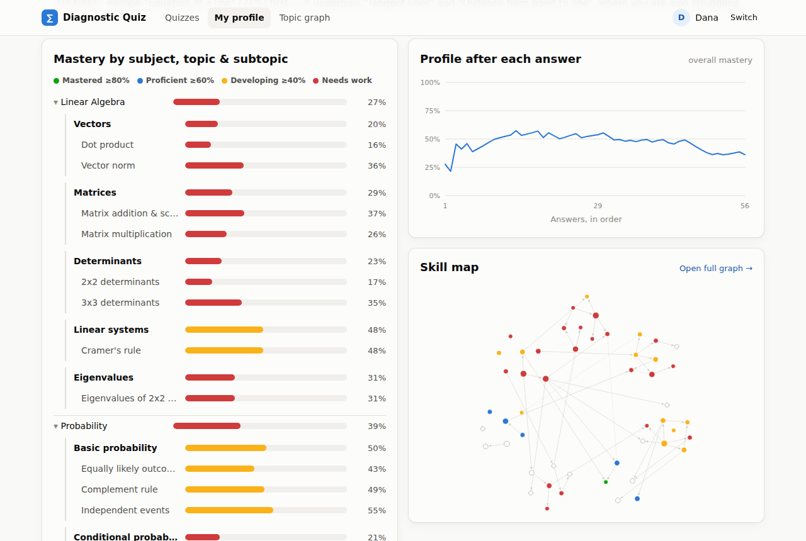
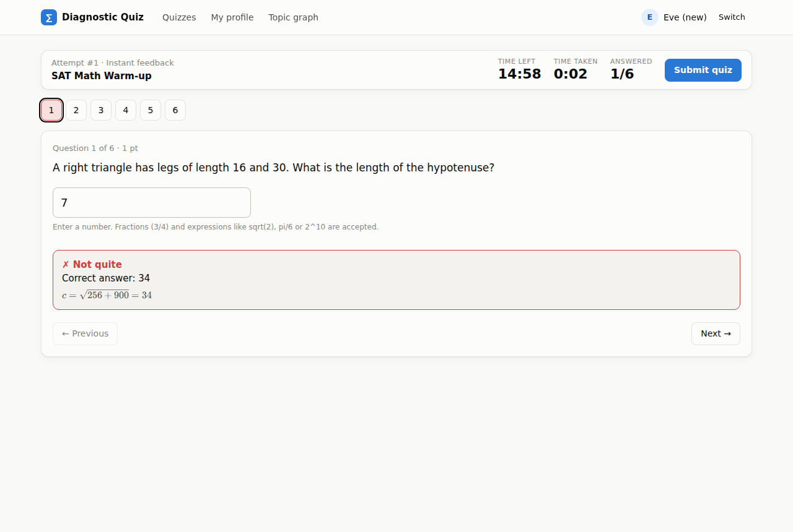
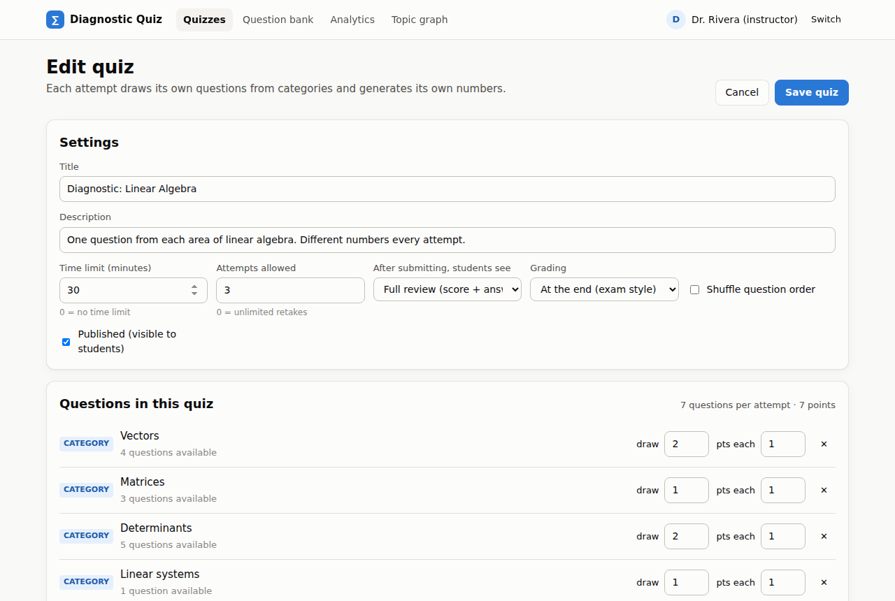
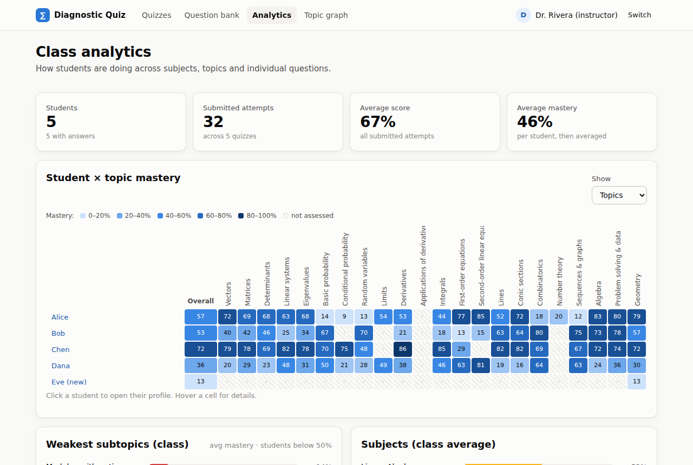
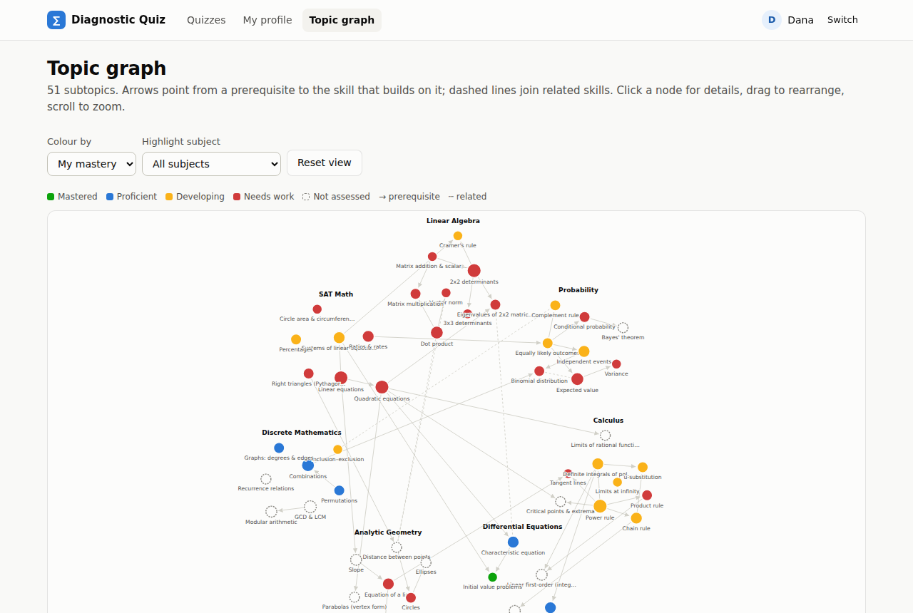

# Diagnostic Quiz System

A math quiz platform in the spirit of Moodle Quiz / WeBWorK, with one extra feature: every graded answer
updates the student's **knowledge profile**, which shows what they are good at, what needs work, and
(using a graph of prerequisite subtopics) what to fix first.

- **Parameterised question bank**: each question is a template with random variables, so every student gets different numbers.
- **Quiz builder**: pick specific questions and/or *categories* (subject → topic → subtopic, difficulty, type) to draw from at random. You set the time limit, number of attempts, whether results are shown, and whether grading happens at the end or after each question.
- **Quiz player**: countdown and elapsed timer, question navigator, autosave, answers such as `3/4` or `sqrt(2)`, and optional instant feedback.
- **Results**: score, number correct, time taken, and a per-question review with solutions (if the quiz allows it).
- **Student profile**: mastery by subject/topic/subtopic, strengths, weaknesses, prerequisite-aware recommendations, how mastery changed after each answer, and a skill map.
- **Topic graph**: an interactive graph of the 51 subtopics, with prerequisite (→) and related (┄) links, coloured by subject or by a student's mastery.
- **Instructor analytics**: a student × topic heatmap, the weakest subtopics class-wide, per-quiz statistics, and item analysis (which questions play harder or easier than their difficulty rating).

No dependencies: Node ≥ 18 and a browser are all you need. KaTeX is vendored in `public/vendor/katex`.

```bash
npm run seed    # optional: 4 simulated students with attempt history (wipes var/)
npm start       # http://localhost:3000
npm test        # unit + API tests
npm run validate  # check every question in the bank (500 random instances each)
```

Sign in by picking a user. Demo users are *Dr. Rivera (instructor)*, *Alice*, *Bob*, *Chen*, *Dana* (her real gap is
algebra, and the recommendations trace calculus trouble back to it) and *Eve (new)*, who has no history yet.

| | |
|---|---|
|  |  |
|  |  |
|  |  |

---

## 1. Question bank format

```
data/
  taxonomy.json          subjects → topics → subtopics, plus the subtopic graph
  bank/<subject>.json    questions, one file per subject
  seed-quizzes.json      sample quizzes created on first start
```

### Taxonomy (`data/taxonomy.json`)

```json
{ "subjects": [ {
    "id": "linear-algebra", "name": "Linear Algebra",
    "topics": [ {
      "id": "la-determinants", "name": "Determinants",
      "subtopics": [
        { "id": "la-det-2x2", "name": "2x2 determinants", "prerequisites": ["la-matrix-ops"] },
        { "id": "la-det-3x3", "name": "3x3 determinants", "prerequisites": ["la-det-2x2"] }
      ] } ] } ] }
```

`prerequisites` are directed edges (A must come before B). `related` are undirected links. Both may cross subjects,
e.g. *Eigenvalues* → requires *Quadratic equations* (SAT). Subtopic ids are global.

### A question (`data/bank/<subject>.json`)

```json
{
  "subject": "linear-algebra",
  "questions": [
    {
      "id": "la-cramer-001",
      "title": "Cramer's rule for a 2x2 system",
      "type": "numeric",
      "difficulty": 3,
      "subtopics": { "la-cramers-rule": 1, "la-det-2x2": 0.5, "sat-systems": 0.3 },
      "text": "Use Cramer's rule to find $x$: $$\\begin{cases} {{a|coef}}x {{b|signedcoef}}y = {{r1}} \\\\ {{c|coef}}x {{d|signedcoef}}y = {{r2}} \\end{cases}$$",
      "variables": {
        "a": { "min": -5, "max": 5, "exclude": [0] },
        "b": { "min": -5, "max": 5, "exclude": [0] },
        "c": { "min": -5, "max": 5, "exclude": [0] },
        "d": { "min": -5, "max": 5, "exclude": [0] },
        "x0": { "min": -6, "max": 6 },
        "y0": { "min": -6, "max": 6 }
      },
      "derived": { "r1": "a*x0 + b*y0", "r2": "c*x0 + d*y0", "D": "a*d - b*c" },
      "constraints": ["D != 0"],
      "answer": "x0",
      "tolerance": { "abs": 0.001 },
      "solution": "$D = {{D}}$, so $x = D_x / D = {{answer}}$."
    }
  ]
}
```

| Field | Meaning |
|---|---|
| `id` | Unique slug. Attempts refer to it, so don't rename it once used. |
| `type` | `numeric` (calculated answer) or `mcq`. |
| `difficulty` | 1–5. Used by the mastery model: a hard question answered correctly counts for more. |
| `subtopics` | `{ subtopicId: weight }`. The **first** entry is the primary subtopic and must belong to the file's subject. The others are related skills the question also exercises, with weights in (0, 1]. Topics and subject are derived from these. |
| `text` | Problem text. Math goes between `$…$` / `$$…$$` (rendered by KaTeX). `{{ expr }}` inserts a computed value. In JSON, backslashes are doubled: `\\frac`. |
| `variables` | Random parameters: `{min, max, step?, exclude?}` (step defaults to 1; `step: 0.05` gives decimals) or `{choices: [...]}`. |
| `derived` | Values computed from the variables, in order. Handy for building problems *backwards* from a nice answer, as in the example above. |
| `constraints` | Expressions that must all be true, otherwise the variables are redrawn (up to 500 tries). |
| `answer` | Formula for the correct value. |
| `tolerance` | `{abs: ε}` and/or `{rel: r}`: accepted if \|x − answer\| ≤ ε or ≤ r·\|answer\|. Default `abs 1e-6`. |
| `answerDisplay`, `displayDecimals` | How the correct answer is shown in reviews, e.g. `"${{answer\|frac}}$"`. |
| `inputHint` | Shown under the answer box, e.g. "Round to 2 decimals". |
| `solution` | Worked solution template (shown in review / instant feedback). |
| **MCQ from formulas** | `answer` + `distractors` (formulas for typical mistakes) + `optionTemplate` (e.g. `"$k = {{value\|frac}}$"`) + `numOptions` (default 4). Duplicate options are removed and topped up with nearby values. Options are shuffled per student. |
| **MCQ with fixed choices** | `choices: [{ "text": "...{{var}}...", "correct": true }, ...]` (exactly one correct; the text can still use variables). `shuffle: false` keeps the order. |
| `points` | Default points (a quiz can override). |

**Expressions** (answers, derived values, constraints, `{{ }}`) use a safe parser; nothing is `eval`'d:
`+ - * / ^ %`, implicit multiplication (`2x`, `3(x+1)`), `== != < <= > >=`, `&& || !`, `cond ? a : b`, `n!`,
`sqrt abs exp ln log(x[,b]) sin cos tan asin acos atan floor ceil round(x,n) min max`,
`C(n,k) P(n,k) fact gcd lcm mod powmod(a,k,m)`, and the constants `pi` and `e`.

**Formats** in `{{ expr | fmt }}`: `2` (max decimals), `signed` (`+ 3` / `- 3`), `coef` (hides 1, `-1` → `-`),
`signedcoef` (for `x^2 {{b|signedcoef}}x`), `frac` (LaTeX fraction), `pct`.

**Student input** is parsed with the same engine but without variables, so `0.75`, `3/4`, `75%`, `1,5`, `sqrt(2)/2`,
`√2`, `2pi` and `C(5,2)` are all accepted. While typing, the player shows how it read the input ("read as 0.75").

**Adding questions**: add an object to a bank file and run `npm run validate`. The validator checks the schema, that
formulas only use defined variables, that 500 random instances generate, that every question grades its own answer
as correct, and it lists subtopics that have no questions yet.

## 2. Quizzes and how they are generated

A quiz is a *recipe*, stored in `var/quizzes.json` (created in the UI or seeded from `data/seed-quizzes.json`):

```json
{
  "title": "Diagnostic: Linear Algebra",
  "timeLimitMinutes": 30,          // 0 = no limit
  "maxAttempts": 3,                // 0 = unlimited
  "showResults": "full",           // "full" (score + answers + solutions) | "score" | "never"
  "feedback": "deferred",          // "deferred" (graded on submit) | "immediate" (checked per question)
  "shuffleQuestions": false,
  "published": true,
  "items": [
    { "kind": "question", "questionId": "la-det3-001", "points": 2 },
    { "kind": "pool", "topic": "la-vectors", "count": 2 },
    { "kind": "pool", "subject": "probability", "difficultyMax": 3, "type": "mcq", "count": 3 }
  ]
}
```

When a student starts an attempt (`lib/quizzes.js`):

1. Fixed questions are taken as they are.
2. Each **pool** draws `count` random questions matching subject/topic/subtopic/difficulty/type, without repeating
   anything already chosen. The most specific pools are filled first, and on a retake the student's least-seen
   questions are preferred.
3. The order is shuffled if the quiz asks for it.
4. Each question is **instantiated** with its own seed: variables are sampled, the text rendered, and the answer
   and MCQ options computed. The answer key stays on the server and is never sent to the browser.
5. The deadline is stored on the server. Saves after it (plus a 30 s grace period) are rejected, and expired
   attempts are auto-submitted.

Students can also press **Practice my weak spots**. This builds a personal quiz (instant feedback, no time limit)
from their current recommendations.

## 3. Knowledge profile (the mastery model)

`lib/mastery.js` replays a student's graded answers in chronological order. For a subtopic *s* in subject *S*, the
student's skill is θ = θ_S + δ_s: a general subject ability plus a subtopic-specific deviation. Question difficulty
1–5 maps to b = (d − 3)·0.75. For each answer and each tagged subtopic (weight w):

```
p    = σ(θ_S + δ_s − b)      predicted chance of answering correctly
e    = w · (correct − p)
θ_S += K_S(n) · e            learning rates shrink as evidence accumulates
δ_s += K_s(n) · e
```

**Mastery = σ(θ_S + δ_s)**: the estimated chance of solving a medium question on that subtopic. It is labelled
*Mastered* (≥ 80%), *Proficient* (≥ 60%), *Developing* (≥ 40%), *Needs work*, or *Not assessed*. Topics and
subjects are evidence-weighted averages of their subtopics.

The profile updates after every graded answer. With instant feedback that means straight away. With end-of-quiz
grading it happens on submit, so the profile can't reveal whether an answer was right mid-quiz.

**Recommendations** use the prerequisite graph. For each weak subtopic (< 55%), a weak or untested prerequisite
is flagged as *Fix first* ("Review *Linear equations* first — it underpins *Quadratic equations*…"), true root
causes coming first. A weak subtopic with solid prerequisites gets *Practise*. An untested subtopic whose
prerequisites are all solid gets *Ready next*.

`scripts/seed-demo.js` simulates students from known hidden skill levels using the same response model, so you can
see that the profile recovers them. Tune the learning rates in `lib/mastery.js` to make the profile more or less reactive.

## 4. Project layout and API

```
server.js             HTTP server + JSON API (no framework)
lib/expr.js           safe expression parser/evaluator
lib/engine.js         seeded question instancing, formatting, grading
lib/bank.js           taxonomy + bank loading and validation, subtopic graph
lib/quizzes.js        quiz validation, question drawing, attempts, grading, result visibility
lib/mastery.js        knowledge profile + recommendations
lib/store.js          JSON-file persistence in var/ (swap for a DB later)
public/               single-page app (vanilla JS modules, no build step)
scripts/              seed-demo.js, validate-bank.js
test/                 node:test unit + API tests
```

The API sends user identity in the `X-User-Id` header:
`GET /api/meta`, `GET /api/graph`, `GET|POST /api/users`,
`GET /api/questions[?subject&topic&subtopic]`, `GET /api/questions/:id[/preview?seed=]`,
`GET|POST /api/quizzes`, `GET|PUT|DELETE /api/quizzes/:id`,
`POST /api/quizzes/:id/attempts` (start or resume), `GET /api/attempts/:id`,
`PUT /api/attempts/:id/answers/:index`, `POST /api/attempts/:id/submit`,
`GET /api/users/:id/profile`, `POST /api/users/:id/practice`, `GET /api/analytics`.

### Before real use

- **Authentication.** Sign-in is a demo user picker, and identity is just a header. Put real auth (sessions, SSO or
  LTI from your LMS) in front of `handleApi`.
- **Storage.** JSON files are fine for a class-sized pilot on one server. `lib/store.js` is the only file to
  replace for Postgres or SQLite.
- **"Results hidden" quizzes** still feed the aggregated profile. That is by design (diagnostic use), but it means
  a student could infer something from profile changes after an exam-mode quiz.
